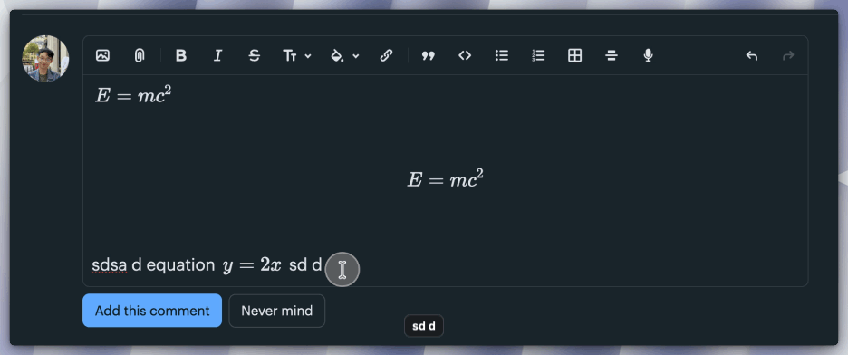
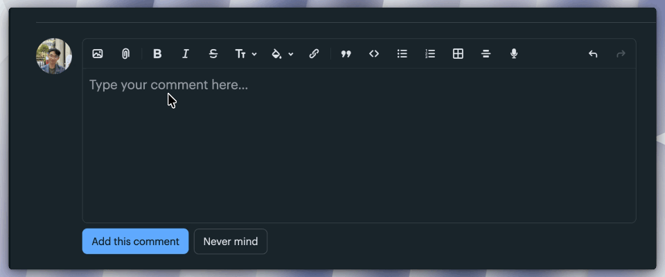

<p align="center">
  
</p>

<h1 align="center">Math for Basecamp</h1>

<p align="center">
  Type LaTeX in Basecamp messages and comments. It renders as you type.
</p>

<p align="center">
  <a href="https://github.com/CharlieLeee/lexxy-math-basecamp/releases/latest"></a>
  <a href="https://github.com/CharlieLeee/lexxy-math-basecamp/actions/workflows/ci.yml"></a>
  <a href="https://www.npmjs.com/package/lexxy-math"></a>
  <a href="LICENSE"></a>
</p>

<p align="center">
  
</p>

An unofficial browser extension that adds math to [Basecamp](https://basecamp.com)'s editor, rendered with KaTeX. Built on [lexxy-math](https://github.com/CharlieLeee/lexxy-math), the math extension for [Lexxy](https://github.com/basecamp/lexxy), the editor Basecamp uses.

## Features

<p align="center">
  
</p>

- **Inline math:** type `$E=mc^2$`
- **Block math:** type `$$` on an empty line and press Enter
- **Edit:** click any formula; Escape or Cmd/Ctrl+Enter to confirm
- **Formatting:** bold, italic, underline, strikethrough, colors and links apply to math
- **Posted messages and comments:** `$...$` and `$$...$$` render for anyone with the extension. Without it, colleagues see the LaTeX source
- Prices like `$5 and $10`, code, and escaped `\$` stay text

Not affiliated with or endorsed by 37signals or Basecamp.

## Install

From the Chrome Web Store (once published), or unpacked:

1. Download `lexxy-math-basecamp.zip` from the [latest release](https://github.com/CharlieLeee/lexxy-math-basecamp/releases/latest) and unzip it, or build it (see below)
2. Open `chrome://extensions`, turn on **Developer mode**, click **Load unpacked**, and pick the unzipped folder
3. Refresh any open Basecamp tabs

## How it works

Basecamp bundles Lexxy and exposes it as `window.Lexxy`. The extension runs in the page at `document_start` (`src/loader.js`):

1. When Basecamp assigns `window.Lexxy`, lexxy-math is built against that exact instance, so math nodes share Basecamp's Lexical
2. When `<lexxy-editor>` is defined (Lexxy does this a task later), math is appended to the element's base extensions, so every editor starts with math. Basecamp's own Lexxy configuration is left untouched
3. KaTeX's CSS is inlined with `data:` fonts, which Basecamp's Content Security Policy allows (its CDN is blocked)
4. Posted content (`.formatted_content`) is rendered with lexxy-math's `renderContentMath` and `renderTextMath`, including comments added later

If Basecamp changes how it loads Lexxy, the extension logs a warning and leaves the editor alone.

## Privacy

No data is collected or sent anywhere, and the extension makes no network requests. It runs only on `3.basecamp.com` and `app.basecamp.com`. See [PRIVACY.md](PRIVACY.md).

## Development

```bash
npm install
npx playwright install chromium
npm test          # builds dist/ and runs the browser tests against a Basecamp-like fixture
npm run package   # dist/ zipped as lexxy-math-basecamp.zip
npm run assets    # icons and Chrome Web Store images
```

`test/fixtures/basecamp.html` reproduces how Basecamp loads Lexxy: an async bundle that assigns `window.Lexxy`, deferred element definition, and the relevant CSP.

Releases: bump `version` in `package.json` (the manifest takes it from there) and push a `v*` tag. CI attaches the zip to the GitHub release.

## License

MIT. Bundles [lexxy-math](https://github.com/CharlieLeee/lexxy-math) and [KaTeX](https://katex.org) (both MIT); their licenses ship in `licenses/`.
